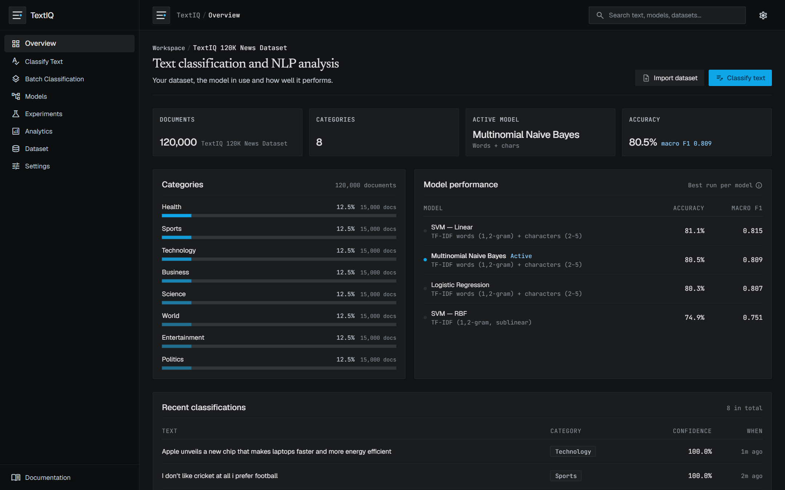
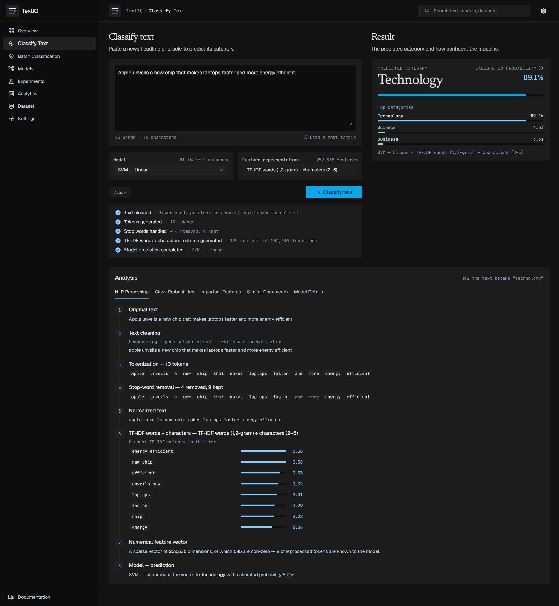
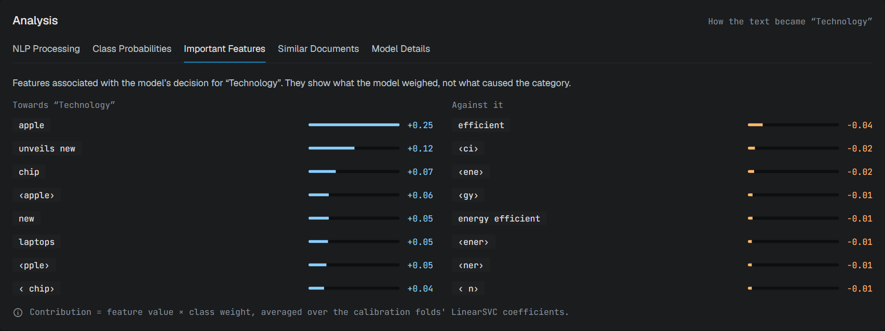
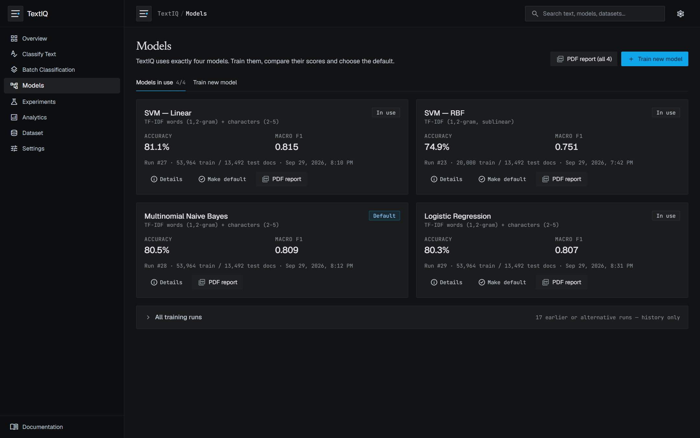
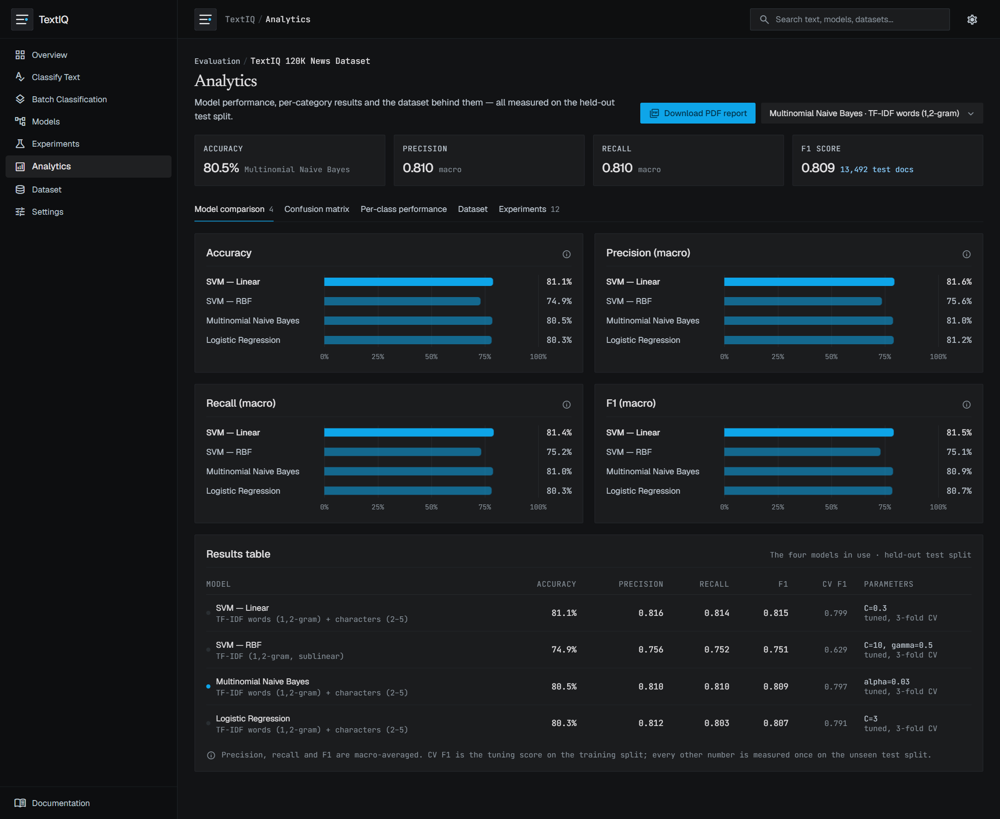
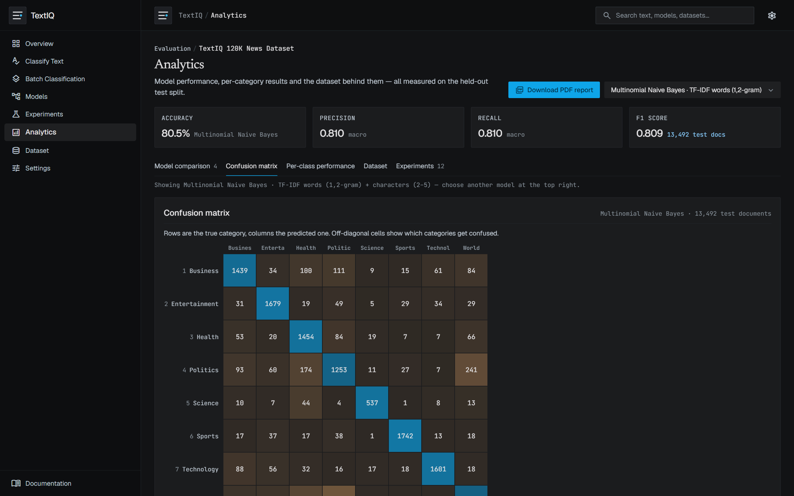
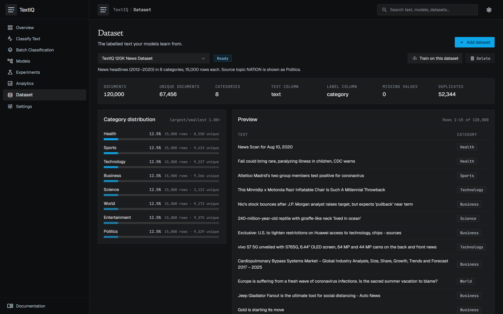
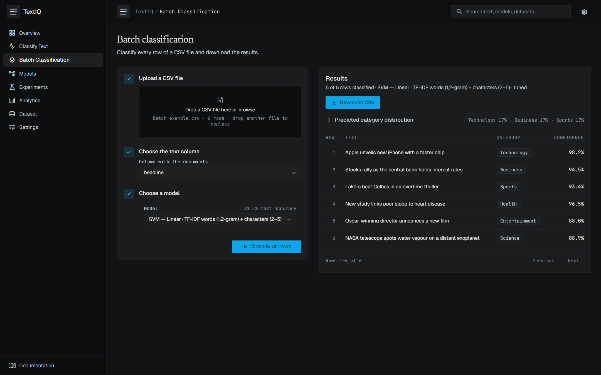

# TextIQ

TextIQ is a news text-classification and NLP analysis platform. It cleans and tokenizes
text, turns it into TF-IDF or Bag-of-Words features, classifies it with one of four
scikit-learn models, reports a technically valid probability, shows which features were
associated with the decision, finds similar documents with cosine similarity, classifies
CSV files in batch, tracks and compares training experiments, and exports the evaluation
results as a PDF report.

The interface follows the Stitch designs for the project (Overview Dashboard and Classify
Text Workspace); their design tokens are ported 1:1 into `frontend/tailwind.config.js`.

## Screenshots

All screenshots show the running application with real, measured results on the
TextIQ 120K News Dataset.

**Overview** — dataset, default model, accuracy, category distribution and recent classifications.



**Classify Text** — enter text, pick one of the four models, and follow the NLP pipeline from
raw text to prediction (cleaning → tokens → stop-word removal → TF-IDF weights → feature vector → model).



**Important Features** — the terms associated with the model's decision, for and against the
predicted category.



**Models** — exactly four models in use, each with its test scores and a PDF report.



**Analytics** — accuracy, precision, recall and F1 of the four models, and the results table.



**Confusion matrix** — true vs. predicted category on the unseen test split.



**Dataset** — rows vs. unique documents, category distribution, preview and quality report.



**Batch Classification** — classify a CSV and download the results
(try it with [`docs/batch-example.csv`](docs/batch-example.csv)).



## Technology stack

| Layer | Technology |
|---|---|
| Frontend | React 18, TypeScript, Vite, Tailwind CSS (no chart library — charts are plain HTML/CSS) |
| Backend | Python 3.10+, Flask (REST API) |
| Machine learning | scikit-learn, pandas, NumPy, SciPy, NLTK (Porter stemmer), joblib |
| Storage | SQLite (`data/intelliclass.db`), joblib model files (`trained_models/`) |

## Architecture

```
frontend/ (React)  ──/api──▶  backend/app.py (Flask)
                                 ├─ routes/        datasets, models, classify, batch, analytics, system
                                 ├─ datasets/      loaders, validation, duplicate-aware training frame
                                 ├─ preprocessing/ text cleaning → tokens → stop words → normalized text
                                 ├─ classification/ feature extraction, the 4-model registry, saved model
                                 ├─ explainability/ per-document feature contributions
                                 ├─ similarity/    cosine-similarity index over the training corpus
                                 ├─ evaluation/    accuracy, precision, recall, F1, confusion matrix
                                 └─ services/      training worker process, model cache, repository
```

Training runs in a separate worker process, so the API stays responsive; predictions load
the saved model and never retrain.

## Dataset

**TextIQ 120K News Dataset** — `TextIQ_120K_Balanced_News_Dataset.csv`, stored at
`data/source/` and loaded from **Dataset → Add dataset**.

| Column | Role |
|---|---|
| `text` | model input (headline) |
| `category` | target label |
| `id`, `source_topic`, `domain`, `published_date`, `link`, `oversampled` | metadata — never used as features |

Eight categories, 15,000 rows each (120,000 rows): Technology, Business, Politics, Sports,
Health, Entertainment, Science, World.

**Category mapping.** The source topic `NATION` is presented as **Politics**
(verified from the file: all 15,000 `NATION` rows carry `category = Politics`; every other
source topic keeps its own name).

**Duplication and leakage.** The file was balanced to 15,000 rows per category by
repeating records — its `oversampled` column is `True` on every row. Measured on the file:

| Check | Value |
|---|---|
| Rows | 120,000 |
| Missing text / category / duplicate ids | 0 / 0 / 0 |
| Rows repeating another row's text | 52,344 |
| Exact copies (same text, link and date) | 51,835 |
| Rows whose text appears under two categories | 816 |
| **Unique, unambiguous documents** | **67,456** |
| Unique per category | Sports 9,415 · Entertainment 9,375 · Politics 9,329 · Business 9,266 · Technology 9,227 · World 9,172 · Health 8,550 · Science 3,122 |
| Length | median 11 words (min 1, max 51) |

Duplication is not limited to Science: every category contains thousands of repeated rows,
and Science keeps only 3,122 unique documents. A random split of the file would put copies
of the same headline into both training and test sets — measured on this file, that inflates
test accuracy by 6–11 points (Naive Bayes +6.2, Linear SVM +8.7, Logistic Regression +11.1). TextIQ therefore uses a **duplicate-aware split**:

```
120,000 rows → remove texts with conflicting labels → keep one copy of each text (67,456)
→ stratified 80/20 split of unique documents (53,964 train / 13,492 test)
→ [optional] oversample smaller categories in the TRAINING split only
→ tune on training data → train → evaluate once on the untouched test split
```

The live quality report on the Dataset page is computed from the file, not hard-coded.
Other datasets remain available: HuffPost News Categories (8 topics) and 20 Newsgroups, or
upload any CSV with a text and a label column.

## Preprocessing and features

1. **Cleaning** — Unicode normalisation, lowercasing, punctuation removal, whitespace normalisation
2. **Tokenization** — word tokens (apostrophes kept inside words)
3. **Stop-word removal** — scikit-learn's English list
4. **Normalized text** — optional Porter stemming
5. **Features** — word + character TF-IDF (`FeatureUnion` of word n-grams and `char_wb` 2–5-grams), `TfidfVectorizer` (default: unigrams + bigrams, sublinear TF, 150,000 terms, min df 1 — chosen by cross-validation on the training split over a 50,000-term, min df 2 setting) or `CountVectorizer` (Bag of Words); character n-grams are available under Advanced settings

The vectorizer is fitted on training data only (inside each CV fold during tuning).

## The four models

TextIQ has exactly **four usable models** — one per type below. Each type has one *deployed*
run; only those four can be used for classification, batch jobs and similarity (the API
rejects any other run with `model_not_deployed`). The first completed run of a type fills its
slot automatically; any other run is kept as history on the Models page and can replace the
current one with **Use as …**. One of the four is the *default*.

| Model | Tuned (3-fold CV on training data) | Confidence reported |
|---|---|---|
| SVM — Linear (`LinearSVC`) | C ∈ {0.1, 0.3, 1, 3} | Platt-calibrated probability (`CalibratedClassifierCV`, sigmoid) |
| SVM — RBF (`SVC`) | C ∈ {1, 10} × γ ∈ {scale, 0.5, 1} | Platt-calibrated probability |
| Multinomial Naive Bayes | α ∈ {0.03, 0.1, 0.3, 1} | Naive Bayes posterior (uncalibrated) |
| Logistic Regression | C ∈ {1, 3, 10, 30} | Softmax posterior |

Raw SVM decision scores are never shown as probabilities; they appear separately as
"SVM margin". Kernel SVM cost grows quadratically with documents, so the RBF SVM is trained
on a stratified subset of the training split (set via *Max training documents*) and tuned on a
6,000-document subset; it is still evaluated on the full test split.

**Explanations** — linear SVM / Logistic Regression: feature value × class weight; Naive
Bayes: feature value × (class log-probability − mean). These are features *associated with*
the decision, not causes. The RBF SVM has no per-feature weights, so no explanation is shown.

## Evaluation

Every run records accuracy, macro and weighted precision / recall / F1, per-category
precision / recall / F1 / support, the confusion matrix, train/test counts per category, the
tuning grid results, and duplicate-removal counts. Results are measured once on the unseen
test split and are never edited. On this dataset (median 11-word headlines, overlapping
topics such as Science / Health / World) the four models reach about 80% accuracy; see the
Analytics page for the current, measured numbers.

## Run

```bash
pip install -r requirements.txt
npm --prefix frontend install
```

Development (two terminals, from this folder):

```bash
python backend/app.py            # API on http://127.0.0.1:5000
```

```bash
npm --prefix frontend run dev    # UI on http://localhost:5173
```

Single process: `npm --prefix frontend run build`, then `python backend/app.py` serves the
UI and API on http://127.0.0.1:5000.

## Use

1. **Load the dataset** — Dataset → Add dataset → *TextIQ 120K News Dataset* (reads
   `data/source/TextIQ_120K_Balanced_News_Dataset.csv`).
2. **Train** — Models → Train new model → choose model, TF-IDF or Bag of Words, n-grams;
   keep *Tune hyperparameters* on. Advanced settings hold C / γ / α, vocabulary size,
   preprocessing, training balance, cross-validation and the RBF document cap.
3. **Classify** — Classify Text → enter text, choose Model and Feature representation →
   *Classify text*. Tabs: NLP Processing, Class Probabilities, Important Features, Similar
   Documents, Model Details.
4. **Batch** — Batch Classification → upload a CSV → choose the text column and model →
   *Classify all rows* → *Download CSV* (adds `predicted_label`, `confidence`, `status`).
5. **Analyse** — Analytics: model comparison charts and table, confusion matrix per model,
   per-class performance, dataset distribution, experiment results.

## PDF report

After training, **Analytics → Download PDF report** (or **Models → PDF report (all 4)**)
downloads an A4 report of the four models in use; each model card and run also has its own
**PDF report**. Contents: dataset summary and duplicate handling, per-category train/test
counts, the model comparison table and accuracy / macro-F1 charts, and for each model its
configuration and tuning result, per-category precision / recall / F1 / support with macro
and weighted averages, and the confusion matrix. Generated with reportlab from the stored
results (`backend/services/report.py`, `GET /api/reports/evaluation.pdf[?model_id=]`).

## Tests

```bash
cd backend
python -m pytest
```

Covers preprocessing, all four models, calibrated probabilities, exact explanation
contributions, cosine similarity, model persistence, duplicate-aware training data, tuning on
training data only, training-only oversampling, and the API's validation and error handling.

## API

All responses are `{"ok": true, "data": …}` or `{"ok": false, "error": {"code", "message", "details?"}}`.

| Method | Path | Purpose |
|---|---|---|
| GET | `/api/health` | Status and library versions |
| GET | `/api/datasets` · `/api/datasets/builtin` | Datasets; built-in datasets and whether loaded |
| POST | `/api/datasets/builtin/{textiq120k\|news8\|20newsgroups}` | Load a built-in dataset |
| POST | `/api/datasets/upload` | Upload CSV (multipart `file`, optional `name`) |
| GET / PATCH / DELETE | `/api/datasets/{id}` | Get, set text/label columns (re-validates), delete |
| GET | `/api/datasets/{id}/preview?offset&limit` | Row preview |
| GET | `/api/models/catalog` | The four classifiers and their tuning grids |
| GET | `/api/models` · `/api/experiments` | All training runs |
| POST | `/api/models/train` | Start a run (`model_type`, `feature`, `tune`, `train_balance`, …) |
| GET / DELETE | `/api/models/{id}` | Run detail; delete run and files |
| GET | `/api/models/deployed` | The four model slots and their runs |
| POST | `/api/models/{id}/deploy` | Use this run for its model type |
| POST | `/api/models/{id}/activate` | Make one of the four the default |
| GET | `/api/reports/evaluation.pdf[?model_id=]` | PDF evaluation report (four models, or one run) |
| GET | `/api/models/{id}/sample` | Random held-out test document |
| POST | `/api/classify` | `{text, model_id?}` → prediction, probabilities, NLP trace, vector terms, explanation |
| POST | `/api/similarity` | `{text, model_id?, k?}` → nearest training documents (cosine) |
| GET / DELETE | `/api/classifications` | Classification history |
| POST | `/api/batch/upload` · `/api/batch/classify` | Batch classification |
| GET | `/api/batch/{job}` · `/api/batch/{job}/download` | Page through / download results |
| GET | `/api/analytics/overview` · `/api/analytics?model_id=` | Dashboard and analytics data |
| GET / PUT | `/api/settings` | Active model, similar-document count, history storage |
| GET | `/api/search?q=` | Search datasets, models and history |

## Other datasets

- **News Categories (8 topics)** — HuffPost headlines + descriptions from the
  [News Category Dataset v3](https://www.kaggle.com/datasets/rmisra/news-category-dataset)
  (R. Misra 2022, CC BY 4.0), 103,741 records after cleaning; imbalanced (17.3×).
- **20 Newsgroups** — via scikit-learn, headers/footers/quotes removed.

## Project layout

```
intelliclass/            (folder name kept for compatibility; the product is TextIQ)
├── backend/             Flask app, ML pipeline, tests
├── frontend/            React + TypeScript + Vite + Tailwind
├── data/                SQLite DB, datasets, source CSV, uploads, batch results
├── trained_models/      saved models, similarity indexes, held-out samples
├── experiments/         JSON run reports
└── requirements.txt
```
